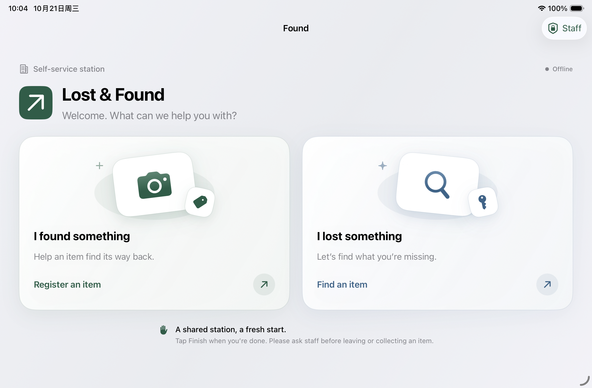

# Found · Native iOS

将旁边 `lost-found-box` 的网页客户端迁移为 **部署在固定失物招领处的 SwiftUI 原生 iPad 终端**。设备由站点统一设置，供现场办理登记和查找使用，不是分发给每位用户的个人 App。沿用 Python 服务和 SQLite 数据，App 内没有 WebView，也不保存 AI API Key。

固定终端定位已记录在 `DESIGN.md`。首页提供「捡到物品」「寻找失物」两个访客任务，结束后清理本次操作并回到首页。工作人员通过设备认证管理站点。iPhone 适配保留为兼容和测试能力。



本仓库包含原生 App、Xcode 工程和测试。Python 后端单独部署；下文的本地服务及联调命令需要旁边存在 `lost-found-box` 目录。API 密钥、证书、数据库和本机运行记录不纳入版本管理。

## 打开与运行

1. 用 Xcode 打开 `Lost&Found.xcodeproj`，选择 `Lost&Found` scheme。
2. 选择 iPhone / iPad 模拟器，点击 Run。最低 iOS 17，无第三方包依赖。
3. 在 App 的 **Staff → Unlock Staff Tools → Connection & device setup → Campus server** 设置服务器地址，点击 **Save & check connection**。工作人员入口使用设备密码 / Touch ID / Face ID，未设置设备密码时保持锁定。

真机默认使用 `https://work123.local:8443`。设备和树莓派须在同一网络，并允许 App 的 Local Network 权限。语音功能需要同步部署本次更新的 `server.py` 和新增的 `speech.py`，沿用已有 `vision.py` 与百炼配置。首次使用项目自签 CA 时，先安装公开 CA 证书，再在 iOS「设置 → 通用 → 关于本机 → 证书信任设置」开启完全信任。不要将证书私钥放入 App；客户端保留系统证书与域名校验。

模拟器默认使用 `http://127.0.0.1:8080`。在 Mac 上从网页项目目录启动原有服务：

```sh
cd ../lost-found-box
python3 server.py
```

模拟器的 localhost 指向 Mac；真机 localhost 指向手机自身。局域网部署使用 HTTPS，HTTP 只允许本机开发地址。真机运行还需 Xcode 中有效的签名团队。

若命令行提示当前目录是 CommandLineTools，可按命令临时指定 Xcode，无需更改全局设置：

```sh
DEVELOPER_DIR=/Applications/Xcode.app/Contents/Developer xcodebuild \
  -project 'Lost&Found.xcodeproj' -scheme 'Lost&Found' \
  -destination 'generic/platform=iOS Simulator' CODE_SIGNING_ALLOWED=NO build
```

## 原生功能

| 页面 | 功能 |
| --- | --- |
| Home | 两个大图标任务入口；iPad 横屏并排，竖屏和大字体上下排列 |
| Report | 系统相机 → 照片确认弹层 → 原地保存进度 → 成功回执 → Finish 回到首页；200 字备注和失败重试 |
| Find | 麦克风为主要入口，最长 30 秒语音转成可编辑描述；键盘输入为辅助，确认后搜索真实候选 |
| Items | 从 Find 浏览最新 100 条记录、总数、下拉刷新、原图和标签 |
| Staff | 设备认证后管理连接设置、相册选图、识别重试及待核实的上传 |

iPad 首页以两个大任务卡片承接访客操作，搜索、详情和设置按内容分成左右两栏；竖屏、窄窗口和辅助功能大字体自动回到单栏。Report 使用拍照入口，随后打开系统确认弹层；iPad 居中展示，iPhone 使用大尺寸 sheet。操作和状态配有 SF Symbols 图标。横竖屏切换保留当前任务和未提交的输入。

视觉与动效按 Apple 当前 Materials、Motion 和 Accessibility 指南完善：首页使用有层次的 SF Symbols 任务图案与原生卡片；玻璃材质用于操作控件，内容保持清晰的不透明底色。iOS 26 使用 Liquid Glass 按钮，旧系统采用原生材质回退。页面轻量入场、按钮按压、照片详情缩放和成功回执动效均尊重“减弱动态效果”；同时适配深色模式、“降低透明度”和增强对比度。

Report 的照片在确认、上传、失败和成功阶段始终保留。保存后照片下方直接展示识别出的标签；识别中自动更新，失败可单独 Retry tagging，不会再次保存或新增物品。未保存时点击 Finish 需确认丢弃；收到服务器保存确认后立即显示成功回执，列表刷新和 AI 标签不会拖延完成反馈。回执的主要操作是 Finish & Return Home，清理屏幕后接待下一位访客。上传中禁用重复操作和结束，失败后可安全重试。

物品主类别和第一个识别标签旁显示匹配的 SF Symbols 图标，覆盖水瓶、钥匙、包、数码设备、衣物和文具等常见失物。Report、物品列表、搜索结果和详情共用本地类别表 `Lost&Found/Core/ItemCategory.swift`；支持常见同义词、复数和格式变化。颜色和特征标签保留文字，未知类别使用通用物品图标。沿用服务端“第一个标签为主类别”的约定，不新增识别请求，也无需下载图标。原始标签文字保持不变。

访客不能进入系统相册或修改服务器。Finish 清理搜索输入、搜索结果、未提交照片、备注、回执和导航；保存的物品和站点配置不受影响。空闲 120 秒显示 30 秒倒计时，可选择 Keep Working；到期自动返回首页。进入后台也会在没有上传进行时复位。旧会话的异步搜索和选图结果不能进入新会话。

保存结果不确定时，结束操作会把原请求留给工作人员核查和重试，下一位访客看不到其照片或备注。为避免覆盖待核实请求，此时暂停新登记，查找仍可使用。这个待处理副本只保存在当前进程中；正式无人值守部署仍需增加持久化恢复能力。

工作人员入口关闭、App 进入后台或入口空闲 120 秒后重新锁定。App 在前台保持屏幕唤醒；正式摆放设备前，工作人员需在 iPad「设置 → 辅助功能 → 引导式访问」完成配置并启动引导式访问。设备密码与已录入生物识别仅供工作人员使用。App 内认证限制界面入口，不替代后端鉴权。

工作人员选择照片无需请求整个相册访问权限。照片先归正方向、缩至最长边 1600 像素，再转为 JPEG；透明区域填白。失败上传保留当前会话中的图片、备注和原始请求 ID，重试不会新增重复记录。提交失败后备注保持锁定，避免同一请求 ID 携带不同内容。退出进程不保证保留尚未完成的草稿。

识别中会在前台轮询；进入后台停止轮询，返回前台刷新。切换服务器清空旧数据和详情导航，过期响应不能覆盖新服务器数据。搜索错误保留输入，空结果与网络错误分别呈现。

## 代码组织

语音只在访客点击麦克风后开始；再次点击停止并识别。取消、离开查找页、进入后台或会话结束都会停止并清理录音。拒绝麦克风权限或识别失败时可以继续键入，已有描述保留。录音以临时 WAV 文件采集（16 kHz、单声道、16-bit PCM），上传前删除临时文件，后端不保存音频或转写记录。识别文字最多 500 Unicode 码点，须确认后才会搜索。

后端通过 `/api/transcribe` 调用百炼 `qwen3-asr-flash`，复用视觉服务的 API Key 与北京地域 host；密钥仅在服务器端。访客界面提示音频会发送至 Alibaba Cloud。若同一 Key 的模型权限不包含 ASR，需要工作人员在百炼配置权限。接口参考：[Qwen ASR 官方文档](https://help.aliyun.com/zh/model-studio/qwen-asr-api-reference)。

- `Lost&Found/Core/`：数据契约、URL 校验、URLSession API 客户端。由 App 与 Swift Package 测试共用源码。
- `Lost&Found/AppStore.swift`：主线程状态、上传重试、搜索、识别和刷新。
- `Lost&Found/UI/`：SwiftUI 页面、组件、相机桥接和图片处理。
- `DESIGN.md`：原生迁移的界面约定，延续网页的英文内容与绿色品牌。
- `Tests/`：Foundation 接口契约测试。
- `NativeTests/`：iOS 图片处理和状态竞争回归测试。

## 验证

```sh
# 核心模型、网络请求及地址校验
DEVELOPER_DIR=/Applications/Xcode.app/Contents/Developer swift test

# 真实 Python 后端联调：临时数据库、无 AI 密钥、自动清理
python3 Tools/verify_api_integration.py

# 原生 XCTest，按本机可用模拟器调整 destination
DEVELOPER_DIR=/Applications/Xcode.app/Contents/Developer xcodebuild \
  -project 'Lost&Found.xcodeproj' -scheme 'Lost&Found' \
  -destination 'platform=iOS Simulator,name=iPhone 17 Pro' \
  CODE_SIGNING_ALLOWED=NO test
```

详见 `verification/README.md`。相机硬件、真实设备权限、项目树莓派证书链和在线 AI 仍需真机联调。当前原后端是可信局域网课堂原型，无登录、领取状态或门锁控制；App 不把“照片已登记”描述为“已经入柜”。

## Apple 参考

- [Materials / Liquid Glass](https://developer.apple.com/design/human-interface-guidelines/materials)
- [Motion](https://developer.apple.com/design/human-interface-guidelines/motion)
- [Accessibility](https://developer.apple.com/design/human-interface-guidelines/accessibility)
- [自定义 SwiftUI 控件的 Liquid Glass](https://developer.apple.com/documentation/swiftui/applying-liquid-glass-to-custom-views)
- [SwiftUI Observation](https://developer.apple.com/documentation/swiftui/managing-model-data-in-your-app)
- [系统 Photos Picker](https://developer.apple.com/videos/play/wwdc2023/10107/)
- [原生 Sheets](https://developer.apple.com/design/human-interface-guidelines/sheets)
- [进度反馈](https://developer.apple.com/design/human-interface-guidelines/progress-indicators)
- [本地网络隐私](https://developer.apple.com/documentation/technotes/tn3179-understanding-local-network-privacy)
- [NSAllowsLocalNetworking](https://developer.apple.com/documentation/bundleresources/information-property-list/nsapptransportsecurity/nsallowslocalnetworking)
- [手动安装 CA 的信任设置](https://support.apple.com/en-us/102390)
- [引导式访问](https://support.apple.com/en-us/111795)
- [Local Authentication](https://developer.apple.com/documentation/localauthentication/logging-a-user-into-your-app-with-face-id-or-touch-id)
