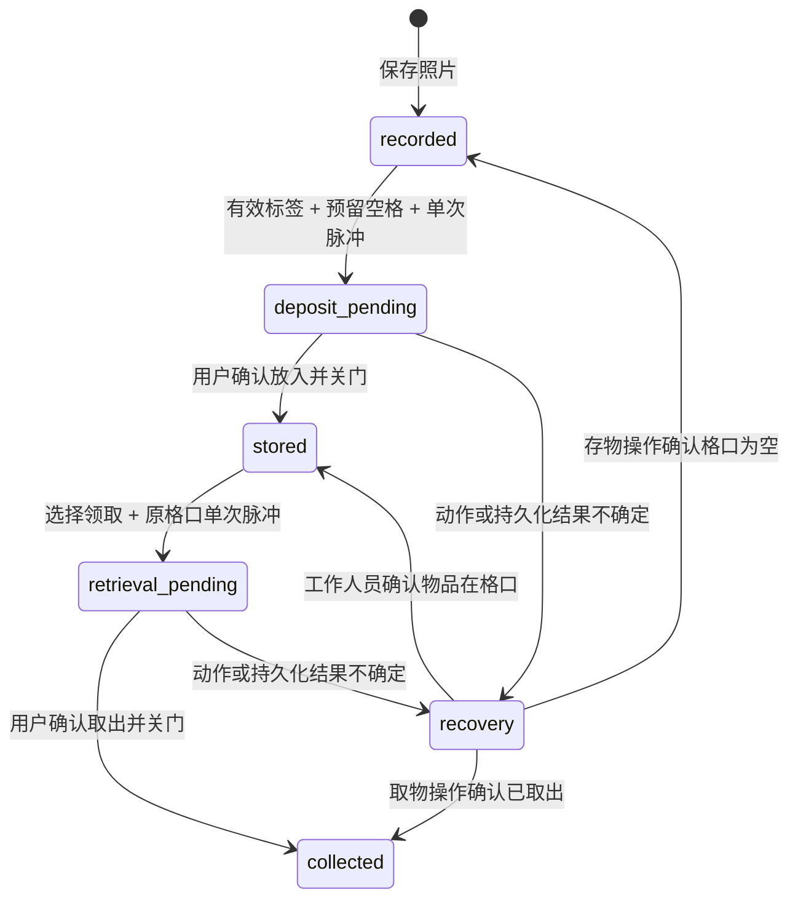

# 硬件接线与四格口状态机

[返回总览](README.md) · 更新：2026-10-22。实现依据：[lockers.py](../../lost-found-box/lockers.py)、[单锁诊断脚本](../../lost-found-box/tools/test_lock_once.py)、[设计契约](../locker-flow.md)。

## 1. 当前方案

Raspberry Pi 4B；四路 S8050 NPN 反相驱动；LOW 触发继电器；5V 电磁柜锁；锁和继电器使用外接电源，树莓派用独立 USB-C 供电。锁样式来自 XG4031-A 5V/2A 选型，最终以实际到货铭牌、触发方式和允许通电时间为准。

| 格口 | BCM 编号 | 40 针排针物理编号 | 默认空闲 | 开锁 |
| --- | --- | --- | --- | --- |
| 01 | 17 | 11 | LOW | 约 0.5 秒 HIGH |
| 02 | 26 | 37 | LOW | 约 0.5 秒 HIGH |
| 03 | 13 | 33 | LOW | 约 0.5 秒 HIGH |
| 04 | 5 | 29 | LOW | 约 0.5 秒 HIGH |

这是当前确认映射，不能沿用旧设计的 17/27/22/23。GPIO5 已分配给第四把锁，不能同时接反馈线。当前演示使用两路独立锁扣反馈及一路震动输入；没有物品在位传感器。

| 输入 | BCM GPIO | 物理针 | 接法与判定 |
| --- | --- | --- | --- |
| 01 锁扣 | 12 | 32 | 无源触点另一端接 GND，内部上拉；LOW 已扣住、HIGH 未关闭 |
| 02 锁扣 | 18 | 12 | 与 01 相同，独立消抖和错误状态 |
| 盒体震动 DO | 21 | 40 | 模块 VCC 接 3.3V、GND 共地；HIGH 触发 |

03／04 未配置门反馈，保留人工确认。门反馈输入连接的是独立无源触点，不连接锁的 5V 电源线。完整接口说明见[门反馈](../door-feedback.md)和[震动监测](../vibration-monitoring.md)。

### 单路连接关系

```text
Pi GPIO ── 1 kΩ ── S8050 B
                     │
                   10 kΩ
                     │
公共 GND ────────── S8050 E
继电器 IN ───────── S8050 C

外部 +5 V ── 继电器 DC+
外部 GND ── 继电器 DC− ── Pi GND

外部 +5 V ── 继电器 COM
继电器 NO ── 锁电源正极
锁电源负极 ── 外部 GND
```

器件 B/C/E 顺序、继电器 DC+/DC− 与 IN 端子按实际型号核对；不能仅凭外壳方向推断。Pi、NPN、继电器输入侧按当前非隔离接法共地，**不并联 Pi USB-C 与外接 5V 的正极**。锁电流不经过 GPIO 或树莓派供电脚。NO 为常开，空闲断电，避免误用 NC 导致持续通电。

GPIO HIGH 使 NPN 导通，继电器 IN 被拉 LOW，继电器闭合给锁供电；GPIO LOW 使驱动关闭。旧版 GPIO 直接驱动 LOW 继电器的脚本极性不同，不能直接拿来替换。实际锁的复扣、机械安装、感性负载保护及外部电源容量仍需现场核验，本文件不是完整生产电路设计。多路设计在软件中串行脉冲，不据此省略电源和硬件保护核验。

## 2. 三种运行模式

| 模式 | 配置 | 行为 |
| --- | --- | --- |
| disabled | 默认 / `--locker-mode disabled` | 停用开锁驱动；新开锁请求返回 503 |
| simulated | `--locker-mode simulated`，仅 localhost | 保留真实数据库和 HTTP 状态机，脉冲为空操作，冷却为 0 |
| gpio | 显式启用并提供准确映射 | 导入 lgpio，检查 Pi 4B gpiochip0 和四路是否被占用 |

此模式仅控制开锁输出。门反馈和震动有独立开关，即使 locker-mode 为 disabled／simulated，开启输入监测仍会加载 lgpio 并认领对应引脚。要完全脱离实物 GPIO，使用 disabled／simulated，并显式设置 `LOST_FOUND_DOOR_FEEDBACK_ENABLED=0`、`LOST_FOUND_VIBRATION_ENABLED=0`。

真实配置参考 [lockers.env.example](../../lost-found-box/deploy/lockers.env.example)：

```ini
LOST_FOUND_LOCKER_MODE=gpio
LOST_FOUND_LOCKER_GPIO_MAP=01=17,02=26,03=13,04=5
# 完成两路触点及震动模块接线后启用；本机开发默认均为 0
LOST_FOUND_DOOR_FEEDBACK_ENABLED=1
LOST_FOUND_VIBRATION_ENABLED=1
```

启动硬件模式不等于主动开门。仅明确开始操作时做 preflight、持久化意图，再发脉冲。输出 LOW 初始化，启用下拉；高电平脉冲约 0.5 秒，等待超过 1.5 秒视为异常；清理尝试停止脉冲并恢复 LOW。真实模式每锁 30 秒冷却，默认不自动重试。

软件清理不能保证系统冻结、断电、SIGKILL 或驱动故障下的动作。GPIO 采样验证电平变化，不测量继电器输出、实际锁舌或门位置。

### 输入采样与界面

`door_feedback.py` 每 50 ms 采样，两个触点分别稳定 250 ms 后接受状态；超过 1 秒无新样本或读取失败即不可用。输入变化中的 `unknown` 不算已关闭。iPad 在前台存取页面每秒 GET 当前操作，读数超过 3 秒失效；后台每 3 秒刷新。界面显示 **Door not closed / Door closed** 或检查／不可用状态，退出会话、切换服务器或离线会使旧读数失效。

`vibration.py` 接收 GPIO21 边沿，HIGH 触发间隔至少 100 ms；2 秒内累计 5 次产生一条持续报警。开锁脉冲前开始抑制计数 2 秒以过滤机械冲击，不清除已有报警。监测不依赖浏览器打开；报警及确认记录进入 SQLite。后台 **Shaking detected** 弹窗的 **Dismiss** 只关闭显示，**Clear alert** 确认该条报警。它不触发门锁、不改变物品状态，也不是力值测量。

## 3. 软件状态与反馈分别显示

| 实体 | 状态 | 含义 |
| --- | --- | --- |
| 物品 | recorded | 已登记，尚未确认入柜 |
| 物品 | deposit_pending / retrieval_pending | 正在存入/取出，等待人工完成 |
| 物品 | stored / collected | 已确认存入/取出 |
| 物品 | recovery | 物理结果不确定，需检查 |
| 格口 | free / reserved / occupied / retrieving / recovery | 空闲、存物预留、占用、取物中、待检查 |
| 操作 | actuating / awaiting_confirmation / completed / uncertain | 已记录执行意图、待确认、完成、不确定 |
| 格口（人工开门期间） | maintenance | 临时占用，成功后恢复此前的软件状态 |
| 门反馈 | closed / open / unknown / unavailable / not_configured | 扣住、未关闭、检查中、不可用、未配置；与占用状态独立 |

### 正常流转



格口对应 `free → reserved → occupied → retrieving → free`。仅 `stored` 且对应格口 `occupied`、归属相同的物品可领取。分配选首个结束冷却的空格；空闲 01 冷却中可跳过使用 02。

## 4. 幂等与一致性

`operation.id = request_id`，两者为规范 UUID。操作 JSON 为 `{id,kind,item_id,compartment_id,state,error,door}`；`door` 包含启用状态、GPIO、物理针、电平、反馈状态及采样时间，数据库还保存 outcome 和操作时间。GET 快照中的 operations 是尚未完成的操作。

开始操作先获得线程/进程排他保护，SQLite `BEGIN IMMEDIATE` 检查并预留，写 `actuating` 和冷却时间，然后提交，再跨越 GPIO 边界。相同 request_id 和相同 payload 返回当前状态，不再脉冲；同 ID 不同 payload 为 409。同物品/格口的未完成操作唯一约束防止换 ID 绕过。

数据库事务不能与真实电磁锁构成原子事务。脉冲后无法保存成功状态时，标 uncertain 并保留 recovery 格口。若数据库连 recovery 也暂时写不了，后续只在硬件空闲并取得排他锁时恢复遗留 actuating。启动同样转换遗留操作，不重放脉冲、不释放格口。

`complete` 只允许 awaiting_confirmation 新完成；01／02 启用反馈后必须稳定关闭，open／unknown 返回 409，不可用返回 503，拒绝时保持物品和格口归属。关门不会自动完成，访客仍确认物品已放入／取走。相同结果重复确认幂等，已完成请求即使门后来打开也可重读，不影响格口新归属。已完成操作不能改成不同结论。

iPad 在发送前保存原请求，退出或重启不丢弃未完成归属。首页可显式继续 `awaiting_confirmation`，仅 GET 读取并恢复关门/物品确认；已完成旧请求自动清除，不再堵住登记入口。未知结果继续保留，不自动补发开锁。

### 工作人员处置

| 操作 | resolve outcome | 结果 |
| --- | --- | --- |
| deposit | stored | 物品 stored，格口 occupied |
| deposit | empty | 物品 recorded、解除格口归属，格口 free |
| retrieve | collected | 物品 collected，格口 free |
| retrieve | stored | 物品仍 stored，格口 occupied |

resolve 可处理 awaiting_confirmation 或 uncertain，必须先现场检查；**不再次通电**，可在传感器故障时按现场事实处置。网页调用 `/api/admin/locker-operations/<id>/resolve`，受管理员会话保护；iPad 兼容的 `/api/locker-operations/<id>/resolve` 仍属于可信局域网接口，不带后台管理员会话。两者使用同一状态校验。

后台 **Open** 是单独的人工开门操作，不要求填写原因或二次确认；成功后自动结束并恢复原软件格口状态，不把任何物品标成已取走。异常时保留 `maintenance` 与请求 ID；查询和 **Finish** 不再次通电。见[管理台说明](../iot-admin.md)。

## 5. 单锁诊断与服务协调

`tools/test_lock_once.py` 固定 GPIO17。无参数仅检查，不驱动；`--fire` 才实际输出一次脉冲，`--off` 也会主动驱动 LOW，因此不属于只读检查。现场动作前确认接法、供电和是否有人正在使用格口。

```sh
# 树莓派上的只读检查
python3 ~/lost-found-box/tools/test_lock_once.py
```

API 与诊断脚本共享文件锁/冷却协调，不应另起不遵守该约定的程序并行操纵 GPIO。不要用脚本开门绕过已登记的库存状态，否则需现场核对后由业务流程恢复。

2026-10-22 已部署四格后端及两路反馈。用户分别切换 01／02 锁扣并确认界面状态正确变化；当日最新后端 196 项测试和 13 项 Swift/Python HTTP 工作流检查通过。上述自动验证没有发送真实开锁脉冲；两路反馈实测不代表四把实体锁和完整物品存取均已验收，详见[测试与进度](05-verification-roadmap.md)。
