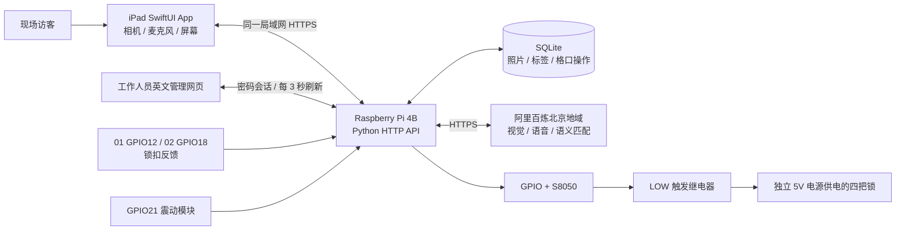

# Found 项目技术文档

更新：2026-10-22（Asia/Shanghai）。对象：小组开发、联调、部署和项目交接。

本文档对应功能版本 `e722f21`：四格存取、英文 IoT 管理台、震动报警、01／02 门反馈及 iPad 未完成步骤恢复。相关代码已上传 GitHub，后端已部署树莓派，最新 App 已安装并启动于真机 iPad。具体测试与现场确认范围见[测试与进度](05-verification-roadmap.md)；本次文档修订不新增设备部署或物理验收结论。

## 阅读入口

| 文档 | 回答的问题 |
| --- | --- |
| [iPad 客户端](01-ipad-client.md) | 页面怎么组织？拍照、语音、访客隔离和中断恢复怎么做？ |
| [后端、API 与 AI](02-backend-api-ai.md) | 数据存在哪里？请求格式、返回值、模型调用和限制是什么？ |
| [硬件与格口状态机](03-hardware-locker-flow.md) | 四路 GPIO 怎么接？何时开锁？不确定状态怎么处理？ |
| [部署与维护](04-deployment-operations.md) | 开发电脑、新 iPad、树莓派怎么运行和连接？如何备份排错？ |
| [测试、进度与待办](05-verification-roadmap.md) | 哪些已证明可用？哪些还需现场验证？如何复现测试？ |

## 1. 项目定位

Found 是固定在校园失物招领点的共享 iPad 终端，配套 Raspberry Pi 4B 和四个独立格口。拾到者拍照登记，AI 提取少量标签；失主用自然语言描述物品，系统从真实库存中返回候选。01／02 自动检测锁扣关闭，03／04 保留人工关门确认；全部格口仍由使用者确认物品已放入或取出。工作人员通过英文网页查看实时信息和手动开门。

团队：Zhekai Mao、Peng Ke、Changpeng Shi、Haozhe Feng。此处记录成员，不推断各人的实际代码贡献。

## 2. 系统架构



AI 提供标签、转写和候选匹配，不直接发出 GPIO 指令。开锁是独立的业务请求，必须通过数据库状态与幂等检查。

| 层 | 当前技术 | 说明 |
| --- | --- | --- |
| 客户端 | SwiftUI、Foundation/URLSession、AVFoundation、LocalAuthentication | iOS 17 起，无 WebView，无第三方包依赖 |
| 服务 | Python 3.10+、ThreadingHTTPServer | 标准库 HTTP/JSON 服务；硬件模式另需 lgpio |
| 存储 | SQLite，WAL、外键、事务 | 图片为 BLOB，与记录共同持久化 |
| 视觉与查找 | 百炼兼容 Chat Completions；默认 qwen3-vl-plus | 短英文标签；文本对标签和备注做语义匹配 |
| 语音 | qwen3-asr-flash | 短 WAV 转写，用户确认后才搜索 |
| 设备控制 | lgpio、S8050、LOW 触发继电器 | 单次约 0.5 秒高电平；真实模式 30 秒冷却 |
| 传感器 | GPIO12／18 无源锁扣触点、GPIO21 数字震动输入 | 门状态独立消抖；连续震动产生后台弹窗 |
| 管理网页 | 原生 HTML/CSS/JavaScript、密码与 Cookie 会话 | 遥测、物品、格口状态、一键 Open、报警确认 |
| 运维 | 项目 CA、HTTPS、用户级 systemd | 私钥和 API Key 不进入客户端或仓库 |

不把最初 proposal 中的 FastAPI、OpenCV、embedding/向量数据库、余弦检索、MQTT、ThingsBoard、TTS 当作已实现功能。

## 3. 完整业务流程

**存物：** 拍照与确认 → 幂等保存照片 → 后台生成有效标签 → 当前登记会话发起独立存物请求 → 原子预留空格并记录操作 → 单次开锁 → 用户放入并关门 → 确认后成为 `stored`。

**取物：** 说话或输入描述 → 修改/确认转写 → 查询可领取库存 → 查看照片和候选理由 → 用户确认选择 → 请求打开该物品的格口 → 用户取出并关门 → 确认后标为 `collected` 并释放格口。

01／02 的两条流程均要求新鲜、稳定的已关闭反馈；iPad 和后端分别校验。关门信号不会自行改变库存。

**中断恢复：** 本机请求日志保留原 ID。首页 **I found something → Continue compartment step** 只查询原操作，恢复待确认的格口步骤；已完成记录自动清理。缺失、离线和不确定状态保持待处理，不自动重放开锁或释放格口。恢复页不显示上一位访客的照片、备注；物理结果不确定时由工作人员检查后处置。

**工作人员：** 登录 `/admin/` 查看遥测、库存和独立门状态；点击 **Open** 发送一次开锁脉冲，不改库存。GPIO21 连续触发产生 **Shaking detected** 弹窗；关闭弹窗与 **Clear alert** 确认报警分别处理。详细契约见[管理台](../iot-admin.md)、[门反馈](../door-feedback.md)和[震动监测](../vibration-monitoring.md)。

## 4. 目录与文档权威范围

本文件的相对路径以 Git 仓库 `Lost&Found/` 为项目根目录。当前主要维护入口如下：

```text
Lost&Found/
├── Lost&Found/                 SwiftUI App、Core、UI、资源
├── Lost&Found.xcodeproj/       Xcode 工程
├── Package.swift / Tests/      Foundation 核心测试
├── NativeTests/               iOS 状态、图像与语音测试
├── Tools/                     Swift → Python 隔离联调
├── lost-found-box/            后端、旧网页、GPIO、部署工具
│   ├── server.py / vision.py / search.py / speech.py / lockers.py
│   ├── iot_admin.py / door_feedback.py / vibration.py
│   ├── static/                admin 管理台 + 兼容照片登记页
│   ├── tests/ / tools/ / deploy/
│   └── config/ certs/ data/    本机运行数据，不进入版本管理
├── docs/technical/            本套现行技术文档
├── docs/locker-flow.md        四格口设计契约与验收要求
├── DESIGN.md                  界面设计约定
└── verification/              原生验证记录与截图
```

外层工作区另有同名 `lost-found-box/`，是早期独立维护/部署来源；本套文档以 **Git 仓库内的后端** 为当前实现依据，不再从两处随意混拷源码。外层 `output/circuit/` 的旧电路草案与当前 GPIO/反馈方案不同；`assessment-one/`、`literature-search/`、`HackTheRest-Ember/` 属于其他作业或项目，不并入 Found。

发生冲突时：运行行为以对应版本源码和测试为准；部署事实以带日期的现场记录为准；proposal 是目标，旧截图是当时界面，不代表最新实现。既有验证记录保留原貌，不能把历史的“尚未实现”当作当前状态。

## 5. 当前边界

- 可信局域网课堂原型。`/api/admin/` 使用独立密码与服务端会话；兼容访客 API 没有统一用户鉴权。App 的 Staff 设备认证只保护本机界面入口。
- 01／02 有锁扣反馈，03／04 无反馈；没有物品在位检测。反馈线断开与锁扣打开都可能读 HIGH，稳定 LOW 也不能证明格口内的物品身份或数量。
- AI 匹配不是所有权认证。身份证/银行卡只做类别识别；提示要求不提取个人字段，但照片本身仍会发给云端。
- 两路反馈已部署，用户分别确认界面随锁扣变化；四格完整的相机／语音／AI／物理存取综合验收仍需单独记录，不能从两路反馈推断全部通过。
- 本文不含真实密钥、密码、证书私钥、用户照片或数据库副本。

## 6. 后续维护约定

新增接口时同步更新 API 文档和契约测试；调整 GPIO 或极性时同步更新硬件文档及假驱动测试；每次部署单独记录日期、源代码版本、备份位置、实测范围和未测范围。自动测试不能替代物理验收。文档中的默认地址优先使用 `work123.local`，IP 只作为带日期的历史记录。
